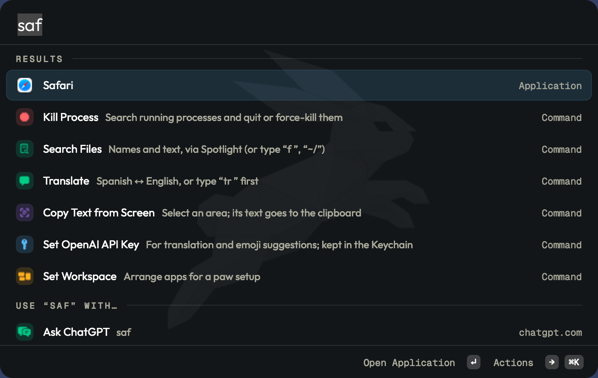

<div align="center">


# hop

**A tiny native macOS launcher.**

Apps, answers, clipboard history, snippets, notes, files and a CLI in one small app (~3 MB binary).<br>
Pure Swift and AppKit, no web views of its own. ~45 MB RAM, 0 % idle CPU.

[](https://github.com/pseudobun/hop/actions/workflows/ci.yml)
[](https://github.com/pseudobun/hop/releases)
[](#install)
[](hop.xcodeproj)
[](LICENSE)

[Install](#install) · [With paw](#with-paw) · [Features](#features) · [Plugins](#plugins) · [Config](#config) · [Permissions](#permissions) · [CLI](#cli) · [Development](#development)

<br>



</div>

> [!NOTE]
> hop is in **beta**. It runs as a daily driver, but config keys and commands may still change
> before 1.0. Read the [changelog](CHANGELOG.md) when you upgrade.

## Install

Requires macOS 26 on Apple Silicon.

### 1. Install with Homebrew

```sh
brew install --cask pseudobun/tap/hop
```

This puts the signed, notarized `hop.app` in `/Applications` and the `hop` CLI on your `PATH`.
Releases are on [GitHub](https://github.com/pseudobun/hop/releases) too (`hop-<version>-macos.zip`).

### 2. Free ⌘Space

System Settings → Keyboard → Keyboard Shortcuts → Spotlight → uncheck *Show Spotlight search*.
Or keep Spotlight and give hop another `general.hotkey`.

### 3. Start hop and allow its permissions

```sh
open -a hop
```

The first launch opens **hop Permissions**: ↵ shows each macOS prompt, **Grant All** asks for all of
them. Only Accessibility is needed for the core (hyper key, pasting, snippets); the rest unlock
single features, see [Permissions](#permissions). Updates keep the grants.

### 4. Check it works

```sh
hop version
hop permissions      # which grants hop has
```

Press ⌘Space and type. Your config is at `~/.config/hop/config.json5` (written on first launch,
commented, nothing personal preset) and applies the moment you save it; ⌘, opens Settings on the
same file. [`examples/config.json5`](examples/config.json5) and
[`examples/snippets.json5`](examples/snippets.json5) are the same templates.

### Updates

hop keeps itself current, without windows or prompts:

1. Once a day it looks for a new version and downloads it in the background.
2. It installs when hop quits, so the next start is the new version.
3. Until then the empty launcher shows **Update hop to …**; ↵ installs it now and restarts hop
   (so does `hop update`, or the menu bar bunny).

| Want | Do |
|---|---|
| Just look | `hop update --check` (the HUD answers) |
| What's waiting | `hop update status` (exit 10 when a version is downloaded) |
| Install right after downloading | `updates.automatic: true` |
| No checks at all | `updates.check: false` |
| Betas too | `updates.channel: "beta"` (a beta build follows betas by itself; `"stable"` leaves them) |
| Homebrew instead | `brew upgrade --cask pseudobun/tap/hop`; betas: `pseudobun/tap/hop@beta` |

Updates are signed (EdDSA) and keep every permission. Builds from source don't check.

### Uninstall

```sh
brew uninstall --cask pseudobun/tap/hop          # add --zap to remove the config and data too
```

### Building from source

A build from source is **hop Dev**: its own bundle id (`com.pseudobun.hop.dev`), data folder,
Keychain items and permissions, no updates and no login item. It runs *instead of* the release hop
without touching it, so you can keep the Homebrew hop installed and switch back and forth.

1. Clone and, optionally, add your Apple Developer team:

   ```sh
   git clone https://github.com/pseudobun/hop && cd hop
   cp Local.xcconfig.example Local.xcconfig   # optional: DEVELOPMENT_TEAM, for signed builds
   ```

2. Without an Apple Development identity, create a stable self-signed one once, so permissions
   survive rebuilds: `just local-cert`.
3. `just dev` builds hop Dev into `~/Applications`, quits the release hop and starts the dev one
   (CLI: `hop-dev`). Grant hop Dev its permissions once.
4. `just undev` quits hop Dev and starts the release hop again. `just uninstall` removes hop Dev.

`just log` follows both. Data of the earlier default id `dev.hop.app` is copied over on the first
launch.

## With paw

[paw](https://github.com/pseudobun/paw) is a tiling window manager by the same author. The two
split the work: hop finds and opens things, paw decides where they go. They talk only through
paw's CLI, so each runs fine alone, and together:

- **Set Workspace** in hop lists paw's setups (`paw setups --json`); ↵ runs `paw initiate`, which
  opens that setup's apps and puts every window where its presets say.
- **Hyper key:** hop's Caps Lock → ⌃⌥⌘⇧ (`hyperKey.enabled`) is the key paw's default bindings
  use, so you need no Karabiner or Hyperkey for paw.
- **Updates:** both update the same silent way. When paw has a new version downloaded, hop's
  launcher shows **Update paw to …** next to its own; ↵ runs `paw update`.
- **Hotkeys:** Set Workspace is a hop command, so `hotkeys: { "Set Workspace": "hyper+l" }` puts
  it on a key. Both CLIs are made for scripts and agents.

Install paw with `brew install --cask pseudobun/tap/paw`; hop finds its CLI on its own.

## Features

- App launcher on ⌘Space with frecency ranking (Raycast-compatible scorer)
  - reopening within `general.keepQueryFor` seconds (10) brings back the last search and row, selected so typing replaces it
  - → at the end of the query, Tab or ⌘K opens the selected result's actions (Tab still completes paths and enters sub-modes)
  - fallbacks under the results, and alone when nothing matches so ↵ runs the first: Ask ChatGPT (sends the query), Search Google, Search GitHub (`general.fallbacks`, also any URL with `{query}`)
- Inline answers, each a card you copy (↵), paste (⌘↵) or copy with its unit (⇧⌘C):
  - calculator and unit conversion (`734h to min`, `1 sq mile = km2`)
  - currencies: `100 usd to eur`, `€50 in gbp`, `1.5k rsd v eur` (open.er-api.com rates, fetched only after you type a currency, at most twice a day; `calculator.currency` is where amounts go without a target)
  - time zones: `time in tokyo`, `5pm london in ljubljana`, `14:00 cet to pst`, `3pm tokyo`
  - dates: `tomorrow`, `in 3 weeks`, `next friday`, `24.12. + 30 days`, `days until christmas`, `days since 1.1.2026`, `week number`, a few in Slovenian (`jutri`, `čez 2 dni`)
  - colours: `#7c5cff`, `rgb(…) to hsl` with a swatch; ⌘K copies HEX, RGB, HSL or a SwiftUI Color
  - Calculator History keeps what you copied or pasted (⌘E calculates it again)
- Uninstall app (with `~/Library` leftovers, `brew uninstall --cask` when it applies), Clear Downloads, Empty Trash
- Kill Process: search running processes, quit, force kill or kill as administrator
- Caps Lock as Hyper key (⌃⌥⌘⇧), optional tap-for-Escape
- Five gentle Caps Lock LED blinks on launch/restart (where macOS supports the LED override), without changing Caps Lock's typing state
- WireGuard: tunnels as pills under the search field with live status (green on, amber activating). Click one to toggle it, or ⌘J to select: ←→ / Tab move, ↵ or Space toggles, Esc back; ⇧⌘J disconnects all; "+N" opens the full list. All keys are in `wireguard.keys` (`direct: "alt+cmd"` adds ⌥⌘1…9), `wireguard.barTunnels` picks and orders the pills, `wireguard.bar: false` hides the bar. Activating one deactivates the others first (`wireguard.exclusive: false` allows several at once). Also connect, disconnect, disconnect all as commands (WireGuard.app tunnels)
- Notes on ⌥. : a keyboard-first floating window over a folder of Markdown files (an Obsidian vault works as is). Search titles and text, live Markdown styling, ⌘E preview with tables, tasks, `[[links]]`, back / forward, pinned notes on top, move to Trash, new notes saved straight into the vault
- Clipboard History on ⇧⌥C, centred like the launcher: text, images, links, colours and files you copied, list on the left and a preview on the right (rendered Markdown, code, colour swatch with HEX / RGB / HSL, images), source app and stats. ↵ pastes into the app you were in, ⌘↵ copies, ⇧⌘P pins, ⌃X deletes, ⌘K for the rest, ⌘P filters by type
- Snippets: type a keyword anywhere (`;mail`) and it becomes the snippet, or search them in hop. Raycast's placeholders (`{clipboard}`, `{date format="…" offset="+1d"}`, `{time}`, `{uuid}`, `{cursor}`, `{argument}`, `{snippet}`, `{calculator}`, `| trim | uppercase` …), checked against Raycast's own parser
- File search on Spotlight's index (always current, no index of hop's own to keep in memory): names first, then files whose text matches, ranked like the launcher with frecency and recency. "f " or "Search Files"; a query starting with `~/` or `/` browses folders, Tab completes. ↵ open, ⌘↵ Show in Finder, ⌘Y Quick Look, ⇧⌘C copy path, ⌥⌘C copy file, ⇧⌘T Terminal, ⌘⌫ Trash
- Shelves (like Dropover): shake the pointer while dragging, or hold ⇧, and a small floating shelf opens under it. Park files, links, images and text, then drag the whole stack (or single rows) out wherever you need them; dragged-out items leave the shelf, and an unpinned shelf closes when empty. Dropping onto the AirDrop zone of an empty shelf sends straight away. Several shelves at once, pin (⌘P), Quick Look (Space), copy (⌘C) or paths (⇧⌘C), Show in Finder (⌘↵), add from clipboard (⌘V), ⌫ removes, ⌥-click × clears. "New Shelf", "New Shelf from Clipboard" and "Reopen Shelf" in hop (or `shelf.hotkey`, `shelf.clipboardHotkey`, `shelf.reopenHotkey`); `hop shelf <paths>` from scripts. Drag detection uses no extra permission
- KeePassXC: several databases (⌘D to switch, or search all), paste or copy password / username / TOTP / URL, favicons, pins, folder filter. Stays unlocked until ⌘L or quit (`keepass.autoLock` locks on sleep, screen lock and inactivity)
- Bookmarks from the config: name, URL, aliases ("hass") and an icon (image file, SF Symbol or emoji); ↵ opens in the default browser
- Emoji picker: "Search Emoji" or type `:` (`:fire`). A grid by category with Recently and Frequently Used on top; ←→↑↓ move, ↵ pastes, ⌘C copies, ⇧⌘C copies the name, ⌥⌘C the code points. Searches CLDR names and keywords in English and Slovenian (`srce`, `pivo`), plus slang and intents (`wtf`, `lol`, `rip`, `ship it`); `emoji.skinTone` for people and hands, ⌘T on one picks another skin tone. Data: `scripts/gen-emoji.py`, narrowed to what this macOS draws
- Settings on ⌘, (in the launcher, "Settings" in root search, or the menu bar bunny): hop's own pages, a Plugins page, then each plugin's page by category (Keyboard, Tools, AI, Integrations, System, Installed) with search, values on the right. Toggles, pickers, steppers and a hotkey recorder write straight into `config.json5`, one key at a time with its comments kept, and apply at once. Bookmarks, KeePassXC databases and `hotkeys` bindings are listed with a button to the file
- Permissions screen: every macOS permission hop needs, with the system prompts (opens on first launch)
- `hop` CLI for scripts and agents

## Plugins

Every feature above is a plugin: core is the launcher, root search, apps, themes, hotkeys,
Settings and the CLI. **Open Plugins** (or Settings → Plugins) turns each one on or off and opens
its settings.

- **Built-in plugins** live in this repository (`hop/Plugins/`), in Swift, with their tests in
  `hopTests/Plugins/`. New ones come as pull requests.
- **Installed plugins** come from a GitHub release and run as their own program; hop draws their
  lists and settings. Write them in any language, or with the Rust (`sdk/rust/hop-plugin`) or
  Swift (`sdk/swift`) SDK:

```sh
hop plugin install github.com/owner/repo     # asks first; --yes installs
hop plugin list
hop plugin remove <id> --yes
```

An installed plugin runs with your user's access to files and the network, but not with hop's
macOS permissions. [docs/plugins.md](docs/plugins.md) has the manifest, the protocol, both SDKs
and the trust model.

## Config

`~/.config/hop/config.json5` (JSON5, comments allowed) is created on first launch and reloaded on save. `HOP_CONFIG` overrides the path. `hop config check` validates it. Settings (⌘,) edits the same file in place: a changed value is replaced where it stands, a missing key is added at the top of its section, comments and layout stay; a symlinked config is written through the link.

`${NAME}` anywhere in the config is replaced by `NAME` from a `.env` file beside it (`KEY=value` lines), or from hop's environment, so the config can sit in a public dotfiles repo while hosts, paths and other private values stay in a gitignored `.env` (or a sops-encrypted `.env.enc` you decrypt on each machine). A name that is not set stays as written and shows as a config warning. The file keeps its placeholders; Settings never writes the values back.

```json5
bookmarks: [ { name: "Dashboard", url: "${DASH_URL}" } ],
```

KeePassXC master password: never put it in the config. Choose `keepass.password`:

| value | where the password comes from |
|---|---|
| `keychain` | typed once in hop, kept in the login Keychain, released after Touch ID (once per hop launch) |
| `prompt` | typed every time the database unlocks |
| `command` | stdout of `keepass.passwordCommand`, e.g. `security find-generic-password -w -s hop-keepass` |
| `none` | database without a password (key file only) |

Notes are plain `.md` files in `notes.folder`; hop keeps no copy. ⌘N starts a note in `notes.newNoteFolder` from `notes.template` (`{{title}}`, `{{date}}`, `{{time}}`). It gets its file name from its title, or from its first line. With `notes.bumpUpdated`, saving an edit sets an existing `updated:` frontmatter date to today. If a file changed elsewhere while it had unsaved edits in hop, the other version is kept next to it as `<name> (conflict).md`.

Notes are keyboard-first; ⌘/ shows every shortcut. The right-hand “On this page” outline lists the current note's headings, with nested levels, click-to-jump and an animated indicator that follows scrolling or the editing caret. It works in both edit and preview modes, updates as you type, and hides for notes without headings or when the window is too narrow.

| Notes key | |
|---|---|
| ⌥. | show / hide (from anywhere) |
| ⌘P (or ⌘O) | search titles and text: title matches first, then notes whose text has every word (phrase and match count rank them). Matches are highlighted, the count shows per note, and opening one jumps to it; ⌘G / ⇧⌘G step through the rest. ↑ ↓ move, ↵ or Tab back to the note |
| search syntax | `"exact phrase"`, `-word` leaves notes out, `path:Infra` (or `in:`) limits to a folder, `#tag` / `tag:x` matches frontmatter `tags:` or inline tags (nested `#a/b` counts for `#a`) |
| ⇧↵ in search | new note named after the search (also ↵ when nothing matches) |
| ⌥⌘↑ / ⌥⌘↓ | previous / next note in the list |
| ⌘[ / ⌘] | back / forward |
| ⌥↵ or ⌘↵ | follow the link at the caret (⌘-click, or a plain click in preview); a missing `[[page]]` starts a new note |
| ⌘E | edit ⇄ preview (rendered, read-only; click a task box to tick it; ↑ ↓ Space scroll) |
| ⌘F, ⌘G, ⇧⌘G | find in the note |
| ⌘N | new note |
| ⌘K | actions, like the launcher: open / preview, pin (⌘D), Obsidian (⇧⌘O), Show in Finder, copy `[[link]]` (⇧⌘C), Markdown (⌥⌘C) or path, Trash (⇧⌘⌫). Acts on the note under the mouse in the list, else the open one; right-click a row for the same list |
| ⌘L / ⌘B / ⌘I | toggle task / bold / italic |
| ⌘\\ | hide the sidebar |
| ⌘D | pin / unpin; pinned notes stay at the top of the list |
| ⇧⌘⌫ | move the note to the Trash (also on right-click in the list) |
| ⇧⌘O | open in Obsidian |
| Esc | close find, then search, then the window (it floats above other apps until then) |

Clipboard history lives in `~/Library/Application Support/<bundle id>/Clipboard` (folder 0700, files 0600). Copies marked concealed or transient (KeePassXC, 1Password, hop's own password pastes) and copies from `clipboard.ignoreApps` are never recorded. Unpinned entries go after `clipboard.keepDays` or beyond `clipboard.maxItems`. Deleting everything takes ⌃⇧X twice.

Every global hotkey is configurable: `general.hotkey` (⌘Space), `notes.hotkey` (⌥.), `clipboard.hotkey` (⇧⌥C), plus a `hotkeys` section that binds any command or app:

```json5
hotkeys: {
  "Empty Trash": "hyper+t",      // a command title (or its id, e.g. "system.emptyTrash")
  "Safari": "hyper+s",           // an app name (or "app:com.apple.Safari"); pressed again while in front, it hides
  "Clipboard History": "hyper+v",
},
```

`hop hotkeys` lists every command you can bind. Bindings show next to their command in the launcher; a binding that clashes with hop's own hotkeys, another app or macOS shows up under Setup.

Snippets live in `~/.config/hop/snippets.json5` (created on first launch, reloaded on save; `snippets.file` moves it):

```json5
[
  { name: "Email", keyword: ";mail", text: "you@example.com" },
  { name: "Meeting", keyword: ";mt", text: "Meeting with {argument name=\"who\"} on {date offset=\"+1d\"}, {cursor}" },
]
```

A keyword expands as soon as it is typed (`snippets.expand`, Accessibility); a keyword that starts with a letter only expands as a whole word unless `snippets.expandWithinWords`. Snippets with `{argument}` ask for the values in hop first. Not in password fields, nor in `snippets.disabledApps`. "Save as Snippet" (⌘S) in the clipboard history adds an entry.

### Themes

hop ships OG, OG Light, Modern, Solarpunk and Cyberpunk; you can add your own. A theme is a JSON5 file in `~/.config/hop/themes/`, and its file name is its id: `nord.json5` is `theme: "nord"`. Every key is optional, anything left out comes from `base`:

```json5
{
  name: "Nord",
  base: "og",            // any built-in theme
  light: false,
  colors: { background: "#2e3440", card: "#3b4252", foreground: "#eceff4", primary: "#88c0d0" },
  fonts: { sans: "Inter", mono: "JetBrains Mono" },  // installed family or PostScript name, "system", "system-mono"
}
```

The Theme command lists your themes next to the built-in ones (with a live preview), and can start a new one from the current theme (**New Theme**), import theme files and their fonts (**Import Theme…**, `.json5`, `.ttf`, `.otf`), or open the folder. Font files anywhere in the folder are loaded for hop only. Saving a theme file applies it at once. [`examples/theme.json5`](examples/theme.json5) lists every key; `hop themes template [base]` prints one, `hop themes` lists them all and `hop themes check` reports problems.

## Permissions

Run **hop Permissions** (it opens by itself on first launch); ↵ shows each macOS prompt, **Grant All** asks for all of them.

| Feature | Permission |
|---|---|
| Hyper key, paste into apps (KeePassXC, clipboard history), snippet expansion | Accessibility |
| Empty Trash, removing protected apps | Automation → Finder |
| Clear Downloads | Downloads folder |
| Notes in iCloud Drive | iCloud Drive access, if macOS asks |
| KeePassXC (`keychain`) | Touch ID / login password |
| Open at Login (`general.openAtLogin`) | Login Items |

## CLI

```sh
hop apps saf --json
hop calc "200 + 10%"
hop uninstall Slack            # dry run, prints what would be removed (exit 3)
hop uninstall Slack --yes
hop downloads clear --yes
hop trash empty --yes
hop wg list | up <name> | down <name> | down-all
hop hyper status | map | unmap
hop ps code                    # processes, busiest first
hop kill 1234 --force --yes
hop kp dbs
hop kp search github --db Work --json
hop kp get github --field totp # password, totp and notes need keepass.cliAccess: true
hop notes list server --json   # title matches, then text matches
hop notes show "Home"
hop notes new "Call Alex" "about the flat"   # or pipe the text in
echo "- [ ] renew domain" | hop notes append TODOs
hop clip list ssh --json       # clipboard history; needs clipboard.cliAccess: true
hop clip copy 3                # put entry 3 back on the clipboard
hop files justfile --limit=5   # Spotlight, names (or --content)
hop snippets expand ";mt" --who=Alex    # a snippet with its placeholders filled in
hop hotkeys                    # hop's hotkeys, the hotkeys section, every bindable command
hop config path | check | show # show: every key with its default filled in, as JSON
hop config get notes.folder
hop config set clipboard.keepDays 30   # one value, comments kept; refused if the config would not read
hop plugin list --json         # plugins, on or off, with their source
hop plugin disable paw         # or enable; writes the config
hop plugin settings keepass --json     # keys, types, defaults and current values
hop plugin set notes folder "~/Vault"
hop plugin install owner/repo --yes    # adds it to plugins.install; hop plugin sync applies that list
hop themes [list] | path | check | template [base]
hop convert 100 usd to eur     # units or currency
hop codes --latest             # newest one-time code from Messages (Full Disk Access)
hop events --days=3 --json     # Calendar; from the running hop when this terminal has no access
pbpaste | hop tr | pbcopy      # between translate.languages with OpenAI ("Set OpenAI API Key" in hop)
hop tr "see you tomorrow" --to=sl
hop ocr screenshot.png         # or no file: select an area on screen; --copy
hop emoji "povit srček"        # the picker's search
hop bookmarks open kvm
hop permissions --json
```

Destructive commands only describe what they would do unless `--yes` is passed. Each plugin
brings its own commands (`hop help` lists them by plugin); installed plugins can add theirs.

## Development

```sh
just build        # Debug
just test         # Swift Testing, golden fixtures in hopTests/Fixtures
scripts/build-local.sh build && open ~/Applications/hop.app --args -DebugShowOnLaunch YES -DebugQuery saf -DebugSnapshotPath /tmp/hop.png
```

Commits follow [Conventional Commits](https://www.conventionalcommits.org). CI builds and tests every pull request that touches the app (docs-only ones skip it; the plugin SDKs build when `sdk/` or `examples/plugins/` change), scans the history for secrets and checks that `examples/` matches the templates (`just examples` regenerates them).

### Releasing

[release-please](https://github.com/googleapis/release-please) keeps a release PR open from the commits on `main` (`VERSION`, `CHANGELOG.md`). Merging it tags the version, and `.github/workflows/release.yml` builds `hop.app` with `scripts/release-build.sh`, signs it with a Developer ID, notarizes and staples it, publishes the zip on the GitHub release, signs it for Sparkle and adds it to the appcast (branch `appcast`), and updates the cask in [`pseudobun/homebrew-tap`](https://github.com/pseudobun/homebrew-tap). `just release` (re)builds a tag by hand.

The workflow needs these repository secrets: `MACOS_CERT_P12_BASE64`, `MACOS_CERT_PASSWORD`, `MACOS_DEVELOPER_ID_APP_CERT` (the identity name), `ASC_KEY_ID`, `ASC_ISSUER_ID`, `ASC_PRIVATE_KEY` (base64 App Store Connect API key, for notarization), `SPARKLE_PRIVATE_KEY` (the EdDSA key that signs updates; its public half is in `scripts/release-build.sh`) and `HOMEBREW_TAP_TOKEN`.

## Contributing

Issues and pull requests are welcome, new built-in plugins included ([docs/plugins.md](docs/plugins.md)). Run `just test` before you open one. Commit messages
follow [Conventional Commits](https://www.conventionalcommits.org).

## License

[MIT](LICENSE) © Urban Vidovič
